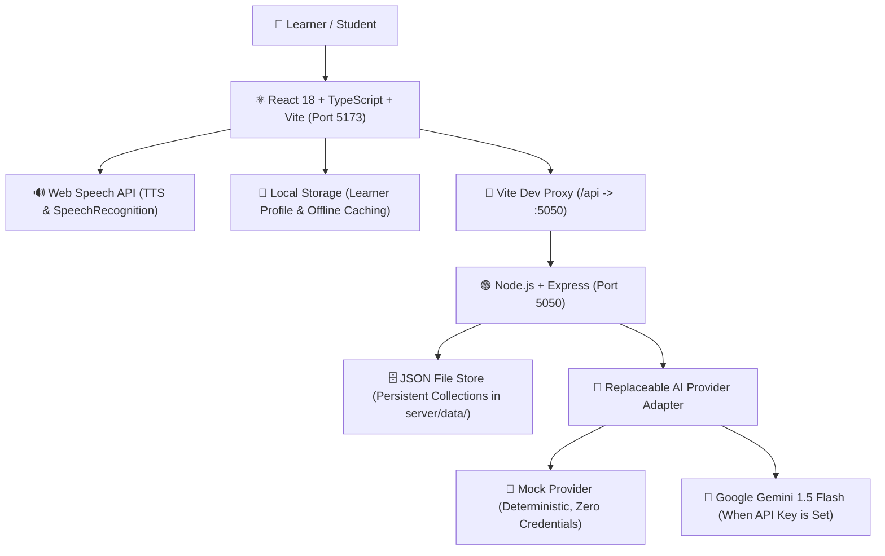

# Kannada for Everyone v3.0 (Unified Platform)

> **Kannada Digital Innovation Hackathon 2026**  
> **Unified AI-Powered Kannada Learning Platform | Class 1–10**

---

## 🌟 Overview & Official Problem Statement

**Kannada for Everyone v3.0** is an interactive, full-stack language education platform engineered to help non-Kannada speakers and school students master practical, everyday, and formal academic Kannada. 

It provides an end-to-end curriculum ranging from complete **Beginner to Class 10**, an instant bilingual dictionary with **AI Deep Explanations**, context-aware **Bidirectional Translation**, an **Adaptive Quiz Arena**, **Homework/Mock Examinations**, **Reading Comprehension**, **Audio Listening Drills**, and **Speaking Pronunciation Studio**.

---

## 🏗️ Architecture & Technology Stack



- **Frontend**: React 18, TypeScript, Tailwind CSS, Vite, Lucide React, React Router v6.
- **Backend**: Node.js, Express, TypeScript (transpiled to CJS), Zod schema validation, Rate limiting.
- **Persistence**: File-system based JSON database (`server/data/`) with automatic indexing and restart survival.
- **AI Integration**: Replaceable provider pattern (`MockAIProvider` vs `GeminiProvider` via `@google/generative-ai`).
- **Speech**: HTML5 Web SpeechSynthesis API with auto-detection for Kannada voices (`kn-IN`).

---

## 🚀 Running the Project Locally

### 1. Start the Backend Server (Terminal 1)
```powershell
cd "C:\Users\abdul khadar\.gemini\antigravity\scratch\kannada-v3\server"
node dist/server.js
```
*Runs on `http://localhost:5050`.*

### 2. Start the Frontend Client (Terminal 2)
```powershell
cd "C:\Users\abdul khadar\.gemini\antigravity\scratch\kannada-v3\client"
node "C:\Program Files\nodejs\node_modules\npm\bin\npm-cli.js" run dev
```
*Runs on `http://localhost:5173` with full `/api` reverse proxy.*

---

## 🔑 Activating Live Google Gemini AI

The application ships with **zero credential requirements** and functions completely in `mock` mode with realistic Kannada data. 

To activate live Google Gemini AI generation:
1. Open `server/.env`
2. Update:
   ```env
   AI_PROVIDER=gemini
   GEMINI_API_KEY=AIzaSy...YourKeyHere...
   GEMINI_MODEL=gemini-1.5-flash
   ```
3. Restart the backend server (`node dist/server.js`). The status badge in the UI will automatically update to **`AI: GEMINI`**.

---

## 📋 Comprehensive Feature Checklist

- [x] **Personalized Learner Profile & Onboarding**: Custom goals, proficiency, explanation language, and grade selection.
- [x] **Class 1–10 Curriculum**: Graded syllabus covering Vowels, Consonants, Verbs, Tenses, Adjectives, Vibhaktis, Historical Reading, Formal Letter Writing, Compound Words, and Classical Vachanas.
- [x] **Full Bilingual Dictionary**: Search by English, Kannada script, or Latin transliteration with part-of-speech, examples, bookmarking, and deep AI explainer modal.
- [x] **Contextual Bidirectional Translation**: English ⇄ Kannada with domain contexts (General, Education, Travel, Healthcare, Shopping, Government).
- [x] **Interactive Vocabulary Builder & Flashcards**: Filter by topics, interactive flip-card drills, and AI batch generation.
- [x] **Grammar Learning Center**: Swaras/Vyanjanas grid, personal pronouns, present tense conjugations, and 7 vibhakti case markers.
- [x] **Real-World Conversations**: Conversational scenarios (Self Intro, Market Shopping, Auto/Travel, Hospital, Hotel) with audio playback.
- [x] **Adaptive Quiz Arena**: On-demand batch generation with instant scoring, feedback explanations, and continuous practice loops.
- [x] **Homework & Mock Exams**: Class-level question paper generation, student answer submission, and automated grading.
- [x] **Reading Comprehension**: Authentic Kannada passages with vocabulary highlights and comprehension checks.
- [x] **Persistent Progress Tracking**: Verified quiz session history, streak calculation, and progress reset controls.
